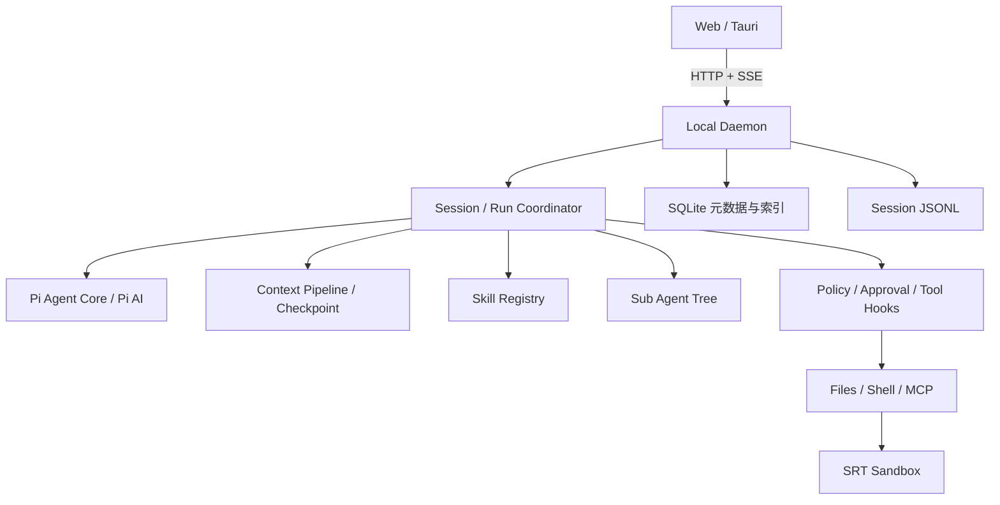

# AgentDock

面向长任务的本地 Agent Harness。基于 Pi Agent Core，在模型与基础 Agent Loop 之上提供任务调度、上下文预算、Skills 加载、多 Agent 协作和工具执行控制。

## 运行时能力

| 模块 | 设计要点 |
| --- | --- |
| 任务生命周期 | 单会话单个顶层任务，支持停止、运行中转向和后续输入排队 |
| 事件持久化 | SQLite 管理元数据与索引，JSONL 顺序追加完整事件，以递增序号组织历史读取和 SSE 重连 |
| 上下文预算 | 独立 Context Pipeline，工具结果裁剪、结构化 Checkpoint 和近期完整工具轮次保留 |
| Agent Skills | 项目与全局技能发现，名称描述先行、正文资源按需读取，当前 Run 与内容指纹约束工具预授权 |
| 多 Agent | 主子执行树、独立消息历史和工具注册表，支持委派、等待、消息传递与递归停止 |
| 工具执行控制 | 策略判定、按需审批、执行前复检，内置文件工具使用路径写入锁和读取指纹 |
| 命令与 MCP | 受监管进程、超时、取消信号、按策略启用的 SRT Sandbox，以及 MCP 工具按需公开 |

Pi Agent Core 与 Pi AI 负责基础执行循环、模型和 Provider 接入；Harness 层负责运行控制、持久化、上下文与工具边界。Web 和 Tauri 提供界面，副作用操作由本机 daemon 执行。

## 架构



daemon 默认监听 127.0.0.1。模型请求仍发送到所选 Provider，本地优先不代表完全离线。

## 恢复与隔离边界

- 重启后恢复会话历史，将未完成 Run、子任务和等待项收束为中止或过期状态；不会自动重放已经执行的工具，也不承诺从中断指令继续运行。
- Checkpoint 用于模型上下文压缩与回退，不是工作区文件快照。
- 子 Agent 拥有独立消息和工具上下文，但共享工作区。内置文件工具的写入锁与读取指纹不构成全部 Shell 修改的事务隔离。
- Skill 正文加载与副作用工具授权分开处理，技能文件自身不能提升权限。
- 沙箱使用受审批模式约束，详见 [Sandbox](packages/sandbox/README.md)。

## 技术栈

- **运行时**：TypeScript strict、Node.js 24+、Pi Agent Core、Pi AI。
- **服务与数据**：Fastify、TypeBox、SQLite、JSONL、HTTP/SSE、pino。
- **工具**：MCP Client、SRT Sandbox、execa、ripgrep。
- **界面**：React 19、Vite、HeroUI、TanStack Query、Zustand、Tauri 2。
- **工程**：pnpm workspace、统一 Catalog、Biome。

## 本地运行

### 1. 准备环境与登录配置

需要 Node.js 24+、pnpm 10+；固定的包管理器版本见 package.json。浏览器开发模式需要自己的 GitHub OAuth App：

```text
Homepage URL: http://127.0.0.1:5173
Authorization callback URL: http://127.0.0.1:4310/api/auth/github/callback
```

```bash
git clone https://github.com/luren619/AgentDock.git
cd AgentDock
cp .env.example .env
```

填写 AGENTDOCK_GITHUB_CLIENT_ID 和 AGENTDOCK_GITHUB_CLIENT_SECRET，检查回调地址。不使用的 OAuth 配置应删除，不保留空值。完整环境变量模板见 [.env.example](.env.example)。

### 2. 安装与启动

```bash
pnpm install --frozen-lockfile
pnpm dev
```

- Web：<http://127.0.0.1:5173>
- daemon：<http://127.0.0.1:4310>

登录后，在模型设置中连接 Provider、选择默认模型，再添加本地工作区。开发数据写入仓库内 .agentdock/，正式运行默认使用 ~/.agentdock/，凭据只由 daemon 管理。

### 3. 可选能力

| 命令 | 用途 |
| --- | --- |
| pnpm dev:docker | 启动本地搜索依赖 |
| pnpm dev:desktop | 启动 Tauri 开发窗口，需要 Rust 与平台构建环境 |
| pnpm --filter @agentdock/computer-use native:build | 构建 macOS Computer Use helper |

Computer Use 需要 macOS 14+ 和用户授予的系统权限，详见 [Computer Use](packages/computer-use/README.md)。普通问答、文件工具和上下文能力不要求启用它。

### 4. MCP、Skills 与数据管理

在设置页添加 MCP 服务并完成所需鉴权；工具通过目录发现和按需加载接入当前 Run，执行遵循审批策略。

Skills 以包含 SKILL.md 的目录组织，frontmatter 至少包含 name 和 description。运行时先提供技能摘要，再按需读取正文与引用资源；具体目录发现规则见 [Skill Registry](packages/tools/src/skill-registry.ts)。

备份数据前停止 daemon，备份完整数据目录，包括 SQLite、WAL、会话 JSONL 和独立凭据文件。恢复后检查会话、Provider 与 MCP 连接；系统权限在目标机器重新确认。配置备份与解密密钥分开保管。

## 检查与评估

```bash
pnpm typecheck
pnpm check
pnpm eval:context
```

`pnpm eval:context:live` 用于真实模型评估，需要先配置模型访问凭据。评估结果应区分静态检查、离线评估与端到端运行。

## 代码导航

| 目录 | 职责 |
| --- | --- |
| packages/agent-runtime/ | Session、Run、事件适配、上下文和子 Agent |
| packages/tools/ | 工具注册、Skill Registry、插件和 MCP 工具发现 |
| packages/policy/ | 路径边界、权限策略和审批 |
| packages/sandbox/ | Shell 与本地 MCP 的隔离和运行管理 |
| packages/providers/ | Pi AI Provider 与模型接入 |
| packages/evals/ | 上下文和会话恢复评估 |
| apps/daemon/ | 本地 API、配置、凭据和持久化 |
| apps/web/ | 对话、设置、任务和运行轨迹 |
| apps/desktop/ | Tauri 薄壳与 sidecar |

## 实现入口

- [运行调度](packages/agent-runtime/src/run-coordinator.ts)
- [上下文处理](packages/agent-runtime/src/context/context-pipeline.ts)
- [Skill Registry](packages/tools/src/skill-registry.ts)
- [子 Agent 执行树](packages/agent-runtime/src/sub-agent-tree.ts)
- [MCP 工具接入](apps/daemon/src/services/mcp-tool-service.ts)
- [Computer Use 运行说明](packages/computer-use/README.md)
- [Sandbox 运行说明](packages/sandbox/README.md)
- [开发约定](AGENTS.md)
